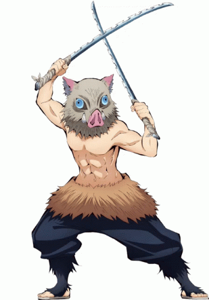
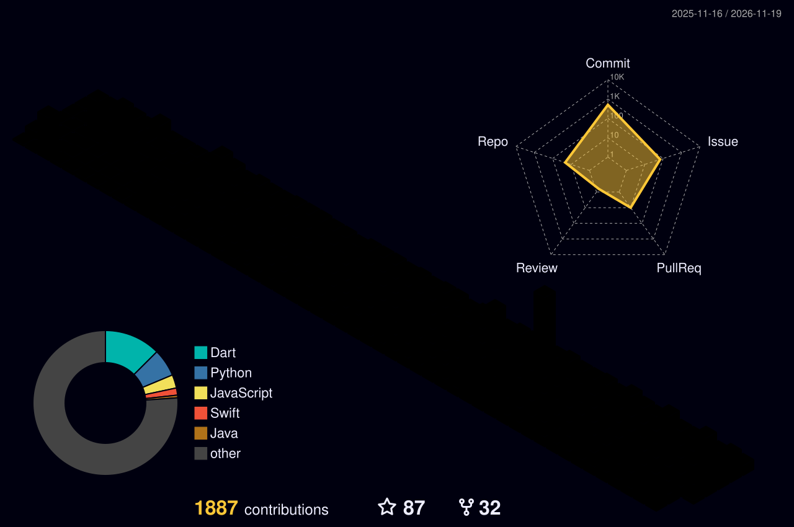

<!-- ©2026 Nipuna Lakruwan | All Rights Reserved | CC BY-NC-ND 4.0 | github.com/Nipuna-Lakruwan | Unauthorized copying is strictly prohibited -->


<div align="center">

<br/>
<a href="https://nipuna-lakruwan.github.io"></a>&nbsp;<a href="https://pypi.org/project/lanka-rag/"></a>&nbsp;&nbsp;
</div>

---

<!-- ©2026 Nipuna Lakruwan | CC BY-NC-ND 4.0 | Do not copy or repurpose -->
## 🧠 Who I Am

<table><tr><td width="33%" align="center" valign="top"><br/><br/><br/><strong>HELLO / ආයුබෝවන් / こんにちは</strong> 👋🏻<br/><br/><a href="https://nipuna-lakruwan.github.io"></a> <a href="https://www.linkedin.com/in/nipuna-lakruwan-6b740627a"></a> <a href="mailto:senarath.lakruwan@gmail.com"></a></td><td width="67%" valign="top">

I started by automating systems: Docker, CI/CD, Linux. Now I build the systems **that think**, and then I measure whether they actually do. Lately that means an open benchmark of which embedding models understand Sinhala (now on PyPI), native macOS apps in SwiftUI, and a Mac that complains out loud through a local LLM. Long story.

> *I don't just run models. I ship them, test them, and occasionally give them feelings.*

```python
class NipunaLakruwan:
    location  = "Kandana, Sri Lanka 🇱🇰"
    education = "B.Sc. Information Technology"
    languages = ["Sinhala", "English", "日本語 (learning)"]
    open_to   = ["Remote work", "AI engineering", "Open source"]

    stack = {
        "ai":     ["Python", "LangChain", "Ollama", "RAG", "embeddings"],
        "apple":  ["Swift 6", "SwiftUI", "Core Audio"],
        "infra":  ["Docker", "GitHub Actions", "Linux", "Redis"],
        "web":    ["React", "Next.js", "Node.js", "PHP"],
    }

    def currently(self):
        return "teaching search engines Sinhala, and my Mac to complain"

    def fuel(self):
        return "Ceylon tea ☕ (an unreasonable amount)"
```

</td></tr></table>

---

<!-- ©2026 Nipuna Lakruwan | CC BY-NC-ND 4.0 | Do not copy or repurpose -->
## 🚀 Featured Projects

### [🇱🇰 lanka-rag](https://github.com/Nipuna-Lakruwan/lanka-rag)
**Which embedding model understands Sinhala?** A reproducible retrieval benchmark of local embedding models on Sinhala, Tamil and Singlish, plus a local RAG assistant over Sri Lankan Acts.

- `bge-m3` leads Sinhala at **0.913** nDCG@10…
- …but a 30-year-old keyword algorithm (BM25) gets **0.899**. I re-ran it three times.
- Singlish is the open problem: the best model reaches **0.31**.

```bash
pip install lanka-rag
```
`Python` `LangChain` `Ollama` `BM25` `PyPI`

<a href="https://github.com/Nipuna-Lakruwan/lanka-rag"><picture><source media="(prefers-color-scheme: dark)" srcset="https://raw.githubusercontent.com/Nipuna-Lakruwan/lanka-rag/main/results/ndcg_heatmap_dark.svg"/></picture></a>

<table>
<tr>
<td width="50%" valign="top">

<a href="https://github.com/Nipuna-Lakruwan/mac-with-feelings"></a>

</td>
<td width="50%" valign="top">

### [💻 Mac With Feelings](https://github.com/Nipuna-Lakruwan/mac-with-feelings)
**Your Mac has feelings now.** A menu-bar app that reads CPU, heat, battery, memory and your 47 browser tabs, then a local LLM says out loud how it feels about it.

> *"47 tabs? I'm literally sweating right now."*

Side effect: my Mac now judges my tab count. It is not wrong.

`Swift 6` `SwiftUI` `Ollama` `AVSpeech`

</td>
</tr>
</table>

| Project | What it does | The honest footnote |
|:---|:---|:---|
| 📱 [Android Mirror](https://github.com/Nipuna-Lakruwan/AndroidMirror-macOS) | SwiftUI front end for ADB and scrcpy | Squinting at the phone on my desk was beneath me |
| 🎚️ [PulseEQ](https://github.com/Nipuna-Lakruwan/PulseEQ) | System-wide 10-band equalizer in the menu bar | My headphones deserved better than "Flat" |
| 🛂 [Visa Photo Guide](https://nipuna-lakruwan.github.io/visa-photo-guide/) | Crop visa photos to official rules, fully in the browser | Smiling is between you and the embassy |
| 🌦️ [Weather Sentinel](https://github.com/Nipuna-Lakruwan/weather-sentinel) | Rain alerts on Telegram via Docker + Actions cron | Sri Lankan rain doesn't send calendar invites |
| 📰 [Lanka News Dashboard](https://github.com/Nipuna-Lakruwan/news-dashboard) | Redis cache vs. no cache, side by side | A very elaborate way of saying "cache it" |
| 🎓 [Face-recognition attendance](https://github.com/Nipuna-Lakruwan/face-recognition-based-attendance-system-py) | Real-time attendance from a webcam | The natural predator of proxy attendance |
| ☕ [Java Project-Based Learning](https://github.com/Nipuna-Lakruwan/Java-Project-Based-Learning) | Progressively harder Java projects for beginners | My most-starred repo. Teaching keeps me honest |

<div align="center"><a href="https://nipuna-lakruwan.github.io"><b>More on my portfolio →</b></a> <sub>(there's a laptop there that talks back)</sub></div>

---

<!-- ©2026 Nipuna Lakruwan | CC BY-NC-ND 4.0 | Do not copy or repurpose -->
## ⚡ The Arsenal

<div align="center">

**🤖 AI & retrieval**<br/>
     

**🍎 Apple platforms**<br/>
  

**☁️ DevOps**<br/>
   

**🖥️ Web & data**<br/>
     

<sub>No percentage bars. Nobody is 90% at FastAPI. Not even FastAPI.</sub>

</div>

---

<!-- ©2026 Nipuna Lakruwan | CC BY-NC-ND 4.0 | Do not copy or repurpose -->
## 🧮 Numbers Nobody Asked For

| | |
|---:|:---|
| **47** | browser tabs open while building my portfolio |
| **4** | pieces Python's `\w` regex chops ජනාධිපතිවරයා into |
| **3%** | free disk space on my Mac. Please send SSDs |
| **0** | frameworks used on my portfolio |
| **∞** | cups of Ceylon tea per benchmark run |

---

<!-- ©2026 Nipuna Lakruwan | CC BY-NC-ND 4.0 | Do not copy or repurpose -->
## 🐍 Snake Is Eating My Commits

<div align="center"><picture><source media="(prefers-color-scheme: dark)" srcset="https://raw.githubusercontent.com/nipuna-lakruwan/nipuna-lakruwan/output/github-contribution-grid-snake-dark.svg"/><source media="(prefers-color-scheme: light)" srcset="https://raw.githubusercontent.com/nipuna-lakruwan/nipuna-lakruwan/output/github-contribution-grid-snake.svg"/></picture></div>

<details>
<summary><b>📈 More stats, for the stats enjoyers</b></summary>
<br/>

<div align="center"></div>

<div align="center"></div>

<div align="center"></div>

<div align="center"></div>

</details>

---

<!-- ©2026 Nipuna Lakruwan | CC BY-NC-ND 4.0 | Do not copy or repurpose -->
## 🌐 Let's Connect

<div align="center"><a href="https://nipuna-lakruwan.github.io"></a>&nbsp;<a href="https://www.linkedin.com/in/nipuna-lakruwan-6b740627a"></a>&nbsp;<a href="mailto:senarath.lakruwan@gmail.com"></a>&nbsp;<a href="https://pypi.org/project/lanka-rag/"></a><br/><br/><em>"The best way to predict the future is to build it. The second best is to benchmark it."</em></div>

<br/>

---

<div align="center"><sub><a href="./LICENSE"></a>&nbsp;</sub><br/><sub>&#169; 2026 <strong>&#78;&#105;&#112;&#117;&#110;&#97;&#32;&#76;&#97;&#107;&#114;&#117;&#119;&#97;&#110;</strong>. All custom design, SVG assets, layout, and content in this repository are protected under the <a href="./LICENSE">CC BY-NC-ND 4.0</a> license.<br/>You may <strong>not</strong> copy, clone, or repurpose any part of this profile without explicit written permission.<br/>Violations may be subject to a <strong>DMCA takedown</strong>. For permissions: <a href="mailto:senarath.lakruwan@gmail.com">senarath.lakruwan@gmail.com</a></sub></div>

<!-- ©2026 Nipuna Lakruwan | CC BY-NC-ND 4.0 | End of profile -->

